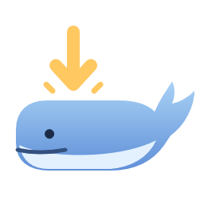
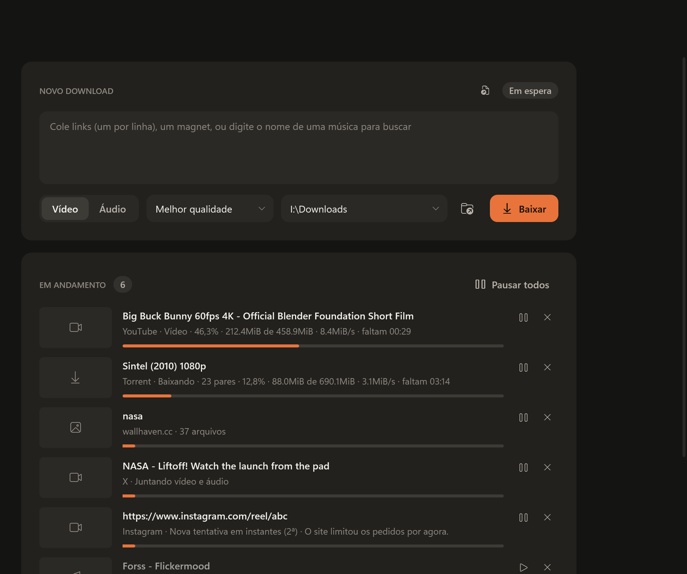

<p align="center">
  
</p>

<h1 align="center">Cachalot</h1>

<p align="center">
  <strong>Cole um link, receba o arquivo.</strong><br />
  Vídeos, músicas, fotos, galerias inteiras e torrents de mais de 1.800 sites, numa fila que se vira sozinha.
</p>

<p align="center">
  <a href="https://github.com/luingry/Cachalot/releases/latest"></a>
  
  
  
  
</p>

<p align="center">
  <a href="#começando"><b>⬇ Instalar</b></a>
  &nbsp;·&nbsp;
  <a href="#como-usar">Como usar</a>
  &nbsp;·&nbsp;
  <a href="#extensão-do-navegador">Extensão do navegador</a>
  &nbsp;·&nbsp;
  <a href="#para-desenvolvedores">Para desenvolvedores</a>
</p>

<p align="center">
  
</p>

## Por quê

Cada site esconde o download de um jeito: o YouTube quer um programa, o Instagram outro, a galeria do DeviantArt um terceiro, e o torrent mais um. O Cachalot junta tudo num lugar só. Você cola o link e ele descobre sozinho de onde é, qual o melhor jeito de baixar e o que fazer se o site resistir.

- **Um campo para tudo.** Links de vídeo, playlists, perfis, galerias, arquivos diretos, magnets ou só o nome de uma música.
- **Escolha a qualidade.** Vídeo de 4K a 360p, ou só o áudio (original, M4A, MP3, Opus, FLAC, WAV).
- **Fila que se vira.** Vários downloads ao mesmo tempo, sem irritar os sites, com novas tentativas automáticas quando algo falha.
- **Pausar é pausar.** Retomar continua de onde parou, até depois de fechar o SwissTechKnife.
- **Do navegador, com um clique.** A extensão manda a página, um link ou um vídeo detectado direto para a fila.
- **Local e privado.** Tudo roda no seu PC; seus cookies e arquivos não saem dele.

> O nome é um trocadilho: o cachalote (*cachalot*) engole o oceano, e o Cachalot *cache a lot*, guarda muito. Antes se chamava **VDGET**.

## Começando

1. Instale o [SwissTechKnife](https://github.com/luingry/SwissTechKnife/releases/latest) e o **Python 3** (`winget install Python.Python.3.12`).
2. No SwissTechKnife, abra **Módulos** → **Cachalot** → **Instalar**.
3. Clique em **Cachalot** na barra lateral, cole um link e pressione **Baixar**.

Recomendado: instale o **FFmpeg** (`winget install Gyan.FFmpeg`) para juntar vídeo e áudio, converter formatos e embutir capa e legendas.

## O que ele baixa

| De onde | Exemplos |
|---|---|
| Sites de vídeo e música | YouTube, Vimeo, SoundCloud, Twitch, Facebook, Bilibili, Kick e mais de 1.800 outros |
| Redes sociais | X, Reddit, Instagram, TikTok, Pinterest, Bluesky, Threads, Douyin: fotos, carrosséis e vídeos |
| Playlists, canais e perfis | Cada item vira um download, na pasta da playlist |
| Galerias de imagem | DeviantArt, Pixiv, ArtStation, Imgur, Tumblr, perfis do X, subreddits e mais de 250 sites |
| Arquivos diretos | `.zip`, `.iso`, `.mp4`, `.pdf`…, com várias conexões e retomada |
| Torrents | Links magnet e arquivos `.torrent` |
| Players escondidos | Páginas que tocam vídeo sem expor o arquivo |
| Só o nome | “artista - música” busca no YouTube e baixa o primeiro resultado |

## Como usar

| Você quer… | Faça assim |
|---|---|
| Baixar alguma coisa | Cole o link (ou vários, um por linha) e clique em **Baixar** |
| Baixar só o áudio | Troque para **Áudio** e escolha o formato ao lado |
| Mandar um arquivo de links ou um torrent | Arraste o `.txt` ou o `.torrent` para a página |
| Aproveitar um link que você copiou | Ao voltar para a página, ele aparece pronto para adicionar |
| Trocar a pasta de destino | Escolha ao lado do campo; as 10 últimas ficam lembradas |
| Pausar, retomar ou cancelar | Use os botões de cada item, ou os de todos de uma vez |
| Baixar de qualquer lugar | Copie um link e pressione **Ctrl+Alt+D** (ligue o atalho nas configurações) |
| Acompanhar um canal | **Configurações** → **Canais seguidos**: avisa ou já baixa o que for novo |

## Configurações

Ficam na aba **Configurações** do Cachalot no SwissTechKnife:

- **Arquivos:** nome dos arquivos, separar por plataforma, não baixar de novo, regras por site (pasta e formato).
- **Playlists:** inteira ou com limite, em pasta própria.
- **Extras:** metadados e capa embutidos, `.nfo` para Kodi/Jellyfin, capítulos, lives desde o começo, legendas, SponsorBlock.
- **Rede:** downloads simultâneos, conexões por download, novas tentativas, limite de velocidade, proxy.
- **Login nos sites:** cookies por site (pela extensão ou um `cookies.txt`) ou do seu navegador; dá para desligar os cookies de vez ou só em alguns sites.
- **Sistema:** não deixar o PC dormir durante downloads, atalho global, link copiado.

## Extensão do navegador

A extensão para Chrome, Edge e Brave manda para o Cachalot a página atual, um link (botão direito) ou um vídeo detectado na página, com os cookies do site para conteúdo que exige login (se eles são usados é escolha do Cachalot, em **Configurações** → **Login e cookies**). Pelo popup você acompanha o download e, quando termina, abre a pasta do arquivo.

Para instalar: **Cachalot** → **Configurações** → **Extensão do navegador** → **Instalar no Chrome…**. Detalhes em [extension/README.md](extension/README.md).

## Privacidade

- Tudo roda no seu computador. O Cachalot só fala com os sites de onde você pede para baixar.
- A extensão conversa apenas com o Cachalot no próprio PC (`127.0.0.1`), e só depois de pareada com o código das configurações.
- Os cookies que você envia ficam guardados localmente e são usados só nos sites deles. Em **Login e cookies** você desliga todos ou os de um site: aí eles nem são guardados, e nenhum download desse site usa cookies (nem os importados, nem os do navegador).

## Bom saber

- O `yt-dlp` é instalado e atualizado sozinho, uma vez por dia. O gallery-dl e o suporte a torrents são instalados no primeiro uso.
- Sem o FFmpeg, os downloads saem no formato que o site entrega.
- Ter o Deno ou o Node instalado melhora os formatos disponíveis no YouTube.
- Se o YouTube pedir para “confirmar que você não é um robô”, o Cachalot tenta de novo com os cookies do site ou do seu navegador.

## Requisitos

Windows 10 ou 11, [SwissTechKnife](https://github.com/luingry/SwissTechKnife) 0.5 ou mais novo e Python 3.

## Para desenvolvedores

```powershell
powershell -File stk/scripts/build.ps1          # build + testes + pacote do módulo
py -3 -m unittest discover -s tests             # testes do backend Python
```

- [Arquitetura, build, releases e variáveis](docs/DEVELOPMENT.md)
- Problemas conhecidos e soluções: [ERRORS.md](ERRORS.md)
